# Sparrow

Android app that streams phone camera video with MISB ST 0601 KLV metadata over SRT, as a
STANAG 4609 MPEG-TS. It keeps streaming in the background and with the screen off.

The requirements are in the *Sparrow – Product Description & SRS* document; requirement IDs
(VID-1, KLV-3, …) are referenced in the code.

## Screenshots

Rendered on the JVM from the real Compose screens with sample data; a drawn skyline stands in for
the camera feed. Regenerate with `./gradlew :app:testDebugUnitTest`; the PNGs land in
`docs/screenshots/`.

The main screen works like a camera app in both orientations. The viewfinder shows exactly the
streamed frame: the stream is upright for the way the phone is held at Go live (1280×720 in
landscape, 720×1280 in portrait, rotated on the GPU), and the screen stays locked to that
orientation until Stop. Settings, the record button and the menu sit on a rail in landscape and a
bottom bar in portrait; status, profile and link readouts overlay the frame. Pinch or tap a preset
to zoom.

| Portrait · ready | Portrait · live | Portrait · details |
| --- | --- | --- |
| 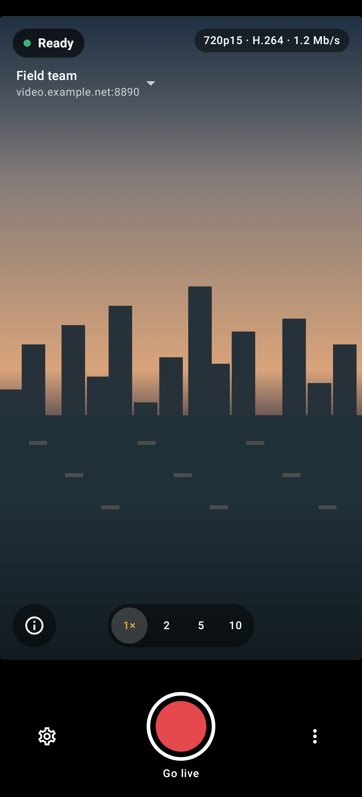 | 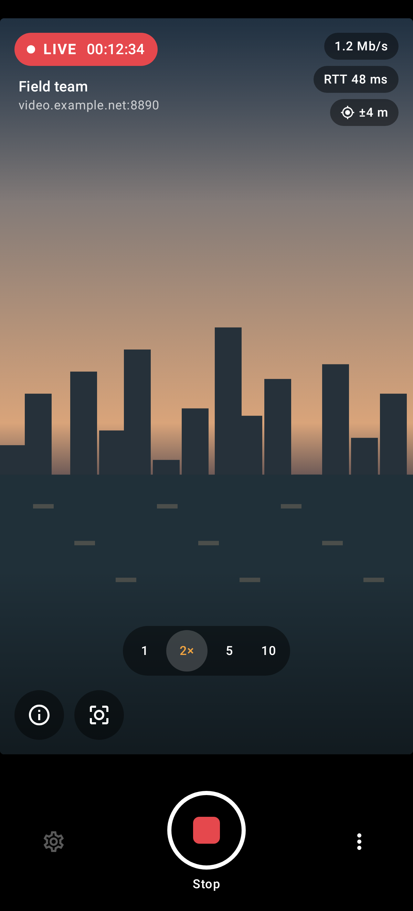 | 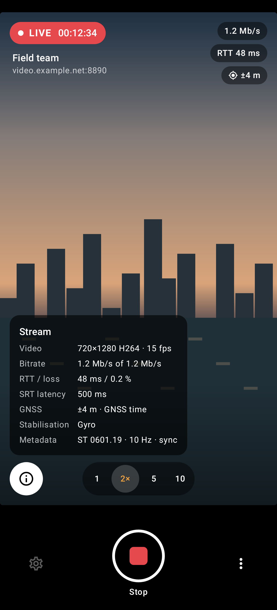 |

| Ready to go live | Live |
| --- | --- |
| 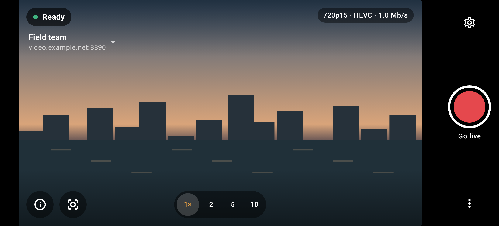 | 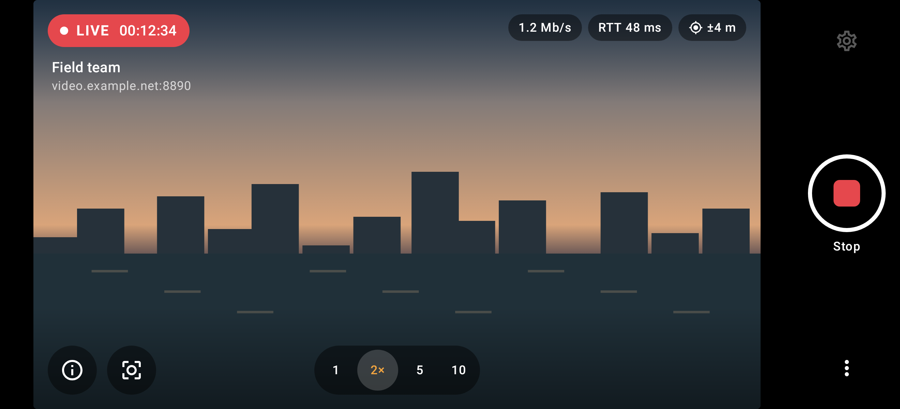 |

| Stream details | Reconnecting, no GNSS fix |
| --- | --- |
| 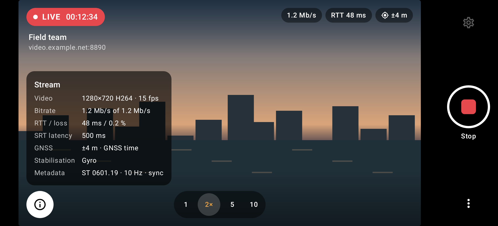 | 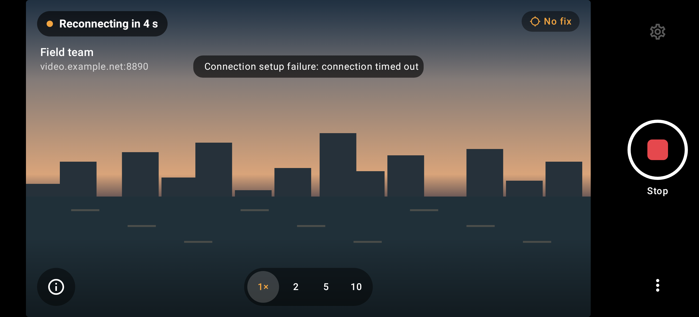 |

| Camera permission needed | First-run guide |
| --- | --- |
| 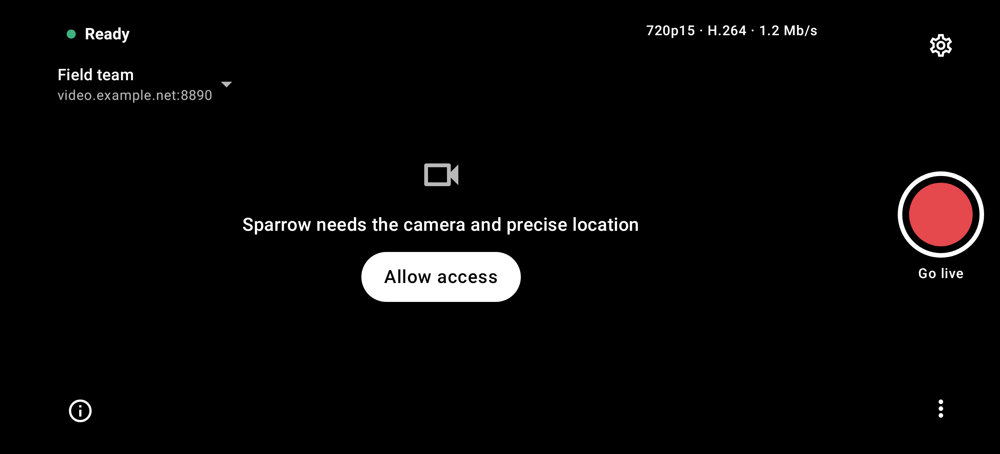 | 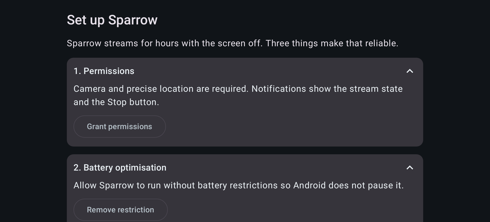 |

| Profiles | Log |
| --- | --- |
| 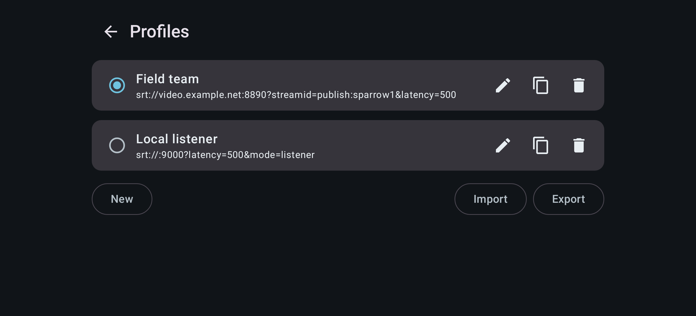 | 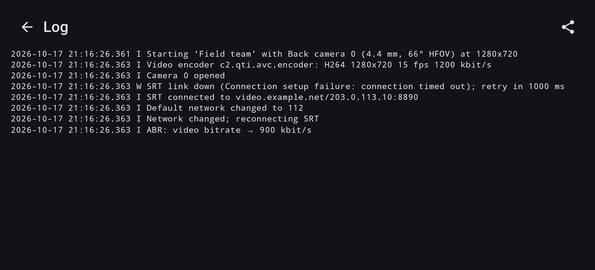 |

| KLV inspector | Settings (full length) |
| --- | --- |
| 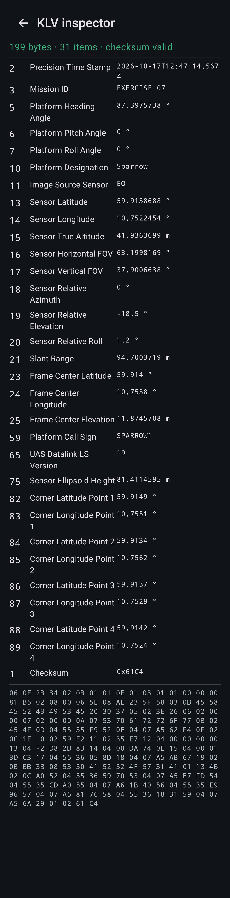 |  |

## Layout

| Module | What it holds |
| --- | --- |
| `core` | Pure Kotlin/JVM, unit-tested: ST 0601 encoder/decoder, ST 1402 TS muxer, Annex B handling, ADTS, frame-center/corner geometry, profiles, `srt://` URLs, reconnect backoff, adaptive bitrate. |
| `app` | Android app: foreground service, Camera2 → MediaCodec, GNSS/orientation sensors, SRT (libsrt through [srtdroid](https://github.com/ThibaultBee/srtdroid)), Jetpack Compose UI. |

Media path, all inside `StreamingService`:

```
Camera2 ──surface──▶ MediaCodec (H.264/H.265) ──▶ AccessUnitAssembler ──┐
GNSS + rotation vector ──▶ MetadataComposer ──▶ St0601Encoder ──────────┼──▶ TsMuxer ──▶ TsChunker (7×188 B) ──▶ SrtSender
AudioRecord ──▶ AAC ──▶ ADTS (optional) ────────────────────────────────┘                    └──▶ local .ts recording (optional)
```

Video, KLV and audio are stamped from one capture clock (`elapsedRealtime`). KLV samples are
taken on video frames, so each KLV PTS equals the PTS of the frame it describes.

## Build

Requirements: JDK 17+ and the Android SDK (platform 37). Gradle is provided by the wrapper.

```sh
./gradlew :core:test          # unit tests, including FFmpeg 7 interop when available
./gradlew :app:assembleDebug  # app/build/outputs/apk/debug/app-debug.apk
./gradlew :app:lintDebug
```

The interop test (`FfmpegInteropTest`) muxes FFmpeg-encoded H.264 with KLV and checks that
`ffprobe` sees an `h264` video and a `klv` data stream, that the video decodes cleanly, and that
the KLV comes back byte-exact with valid checksums, for both sync and async carriage.

It runs against **FFmpeg 7** (with libx264). Point `FFMPEG_HOME` at the directory that holds
`ffmpeg` and `ffprobe`, otherwise `PATH` is used; the test is skipped when that FFmpeg is not
major version 7 (override with `FFMPEG_MAJOR`). A static 7.0.2 build works:

```sh
curl -LO https://johnvansickle.com/ffmpeg/releases/ffmpeg-release-amd64-static.tar.xz
tar xf ffmpeg-release-amd64-static.tar.xz
FFMPEG_HOME=$PWD/ffmpeg-7.0.2-amd64-static ./gradlew :core:test
```

## Receiving the stream

```sh
# Sparrow in caller mode (default) → listen on the receiving machine:
ffplay -fflags nobuffer 'srt://0.0.0.0:9000?mode=listener&latency=500000'
# Inspect the KLV:
ffmpeg -i 'srt://0.0.0.0:9000?mode=listener' -map 0:d -c copy -f data - | xxd | head
```

MediaMTX and SRS accept the stream as a publisher (`streamid=publish:<path>` for MediaMTX).

## Default profile

Tuned for the lowest bandwidth that still gives a clean picture:

| Setting | Default | Why |
| --- | --- | --- |
| Video | 1280×720, 15 fps, H.264 High profile | Half the frames of 30 fps; High profile needs ~10–15% fewer bits than Baseline |
| Bitrate | 1.2 Mbit/s, variable (VBR) | VBR saves bits on static scenes and spends them on motion |
| Keyframe interval | 2 s | Keyframes are the costliest frames; receivers still start at once because every SRT connect requests an IDR |
| Adaptive bitrate | 400–1200 kbit/s | Only lowers the bitrate under congestion, never raises it above the target |
| Metadata | ST 0601 at 10 Hz | About 30 kbit/s with TS overhead |
| Audio | Off | |

The camera is asked for a fixed 15 fps range where one exists, and the encoder drops any frames
above 15 fps. Choosing HEVC in Settings typically cuts another 30–40% at the same quality, if the
receivers support it. The SRS lists 30 fps / 4 Mbit/s / 1 s GOP as defaults; these were lowered on
request.

## Stabilisation

| Mode | What it does |
| --- | --- |
| Gyro (default) | Sparrow integrates the gyroscope (200 Hz) and renders a steadied virtual camera on the GPU with a 10 % crop; fast pans pass through with a little lag. **Level horizon** also rolls the virtual camera so the horizon stays level (20 % crop). |
| Camera | The device's own electronic stabilisation. |
| Off | Raw camera frames. |

In Gyro mode the KLV describes the virtual camera: attitude from the steadied orientation and FOV
reduced by the crop, so frame center, corners and target positions match the streamed picture.
The viewfinder still shows the camera's direct preview, not the stabilised stream.

## Metadata model

A phone has no gimbal, so the platform frame is chosen to keep every angle exact and in range:
platform heading = camera azimuth (true north), platform pitch and roll = 0, and the camera
elevation and roll go in the sensor-relative tags (18–20). Composing platform and relative angles,
as receivers do, gives the true camera attitude.

* Position tags (13–15, 75), frame center, slant range and corners are omitted without a GNSS fix
  newer than 3 s; nothing stale or zero is sent (KLV-6).
* Tag 15 uses MSL altitude from `Location` (API 34+) or NMEA GGA; Tag 75 carries ellipsoid height.
* Frame center and corners come from a flat-earth intersection with the configured ground
  elevation; corners are omitted when any corner ray is above the horizon (KLV-3).
* Tag 2 uses GNSS-derived UTC, falling back to the network-corrected system clock.

## Status

Built and unit-tested; **not yet run on a device**. Everything below needs on-device
verification against the acceptance criteria in the SRS.

| Area | State |
| --- | --- |
| VID-1..4 capture, H.264/H.265, SPS/PPS before IDR, zoom/focus/stabilisation | Implemented |
| VID-5 AAC audio | Implemented (off by default) |
| KLV-1..6 ST 0601 packet, sensor tags, geometry, static tags, tag selection, no-fix handling | Implemented, unit-tested |
| MUX-1..4 TS, sync/async KLV, PCR ≤ 40 ms, PSI ≤ 100 ms, 1316-byte payloads | Implemented, unit- and FFmpeg-tested |
| SRT-1..3, SRT-5 caller/listener, options, reconnect, ABR | Implemented |
| SRT-4 `srt://` URL / QR | Paste from clipboard and QR decoded from an image; live QR scanning not yet |
| BG-1..6 foreground service, locks, notification, handover, onboarding, kill detection | Implemented |
| UI-1..6 camera-style main screen, settings, profiles + JSON, inspector, log export, local recording | Implemented |
| NFR-5 Keystore passphrases, no telemetry | Implemented |
| NFR-7 golden byte vectors | KLV, PAT and ADTS vectors in `core` tests |

Known gaps and notes:

* The ST 0601 example values in `St0601Test` were reproduced from memory of the standard's tag
  tables; check them against the MISB document before relying on them for acceptance.
* Receivers built on FFmpeg 6.x strip a 5-byte metadata AU header from every KLV stream,
  including asynchronous ones that carry none, so async KLV loses its first 5 bytes there.
  FFmpeg 7 fixed this; synchronous carriage (the default) works with both.
* The FOV ignores the small crop added by electronic stabilisation.
* Portrait, reverse-landscape and gyro-stabilised streams go through a GPU stage (`FrameRenderer`);
  its direction and the matching KLV attitude are unit-tested as math only and need checking on
  a device.
* SRT data produced while the link is down is dropped, not buffered.

## Open questions (from the SRS)

* Which ST 0601 version must be claimed? (Tag 65 defaults to 19 and is configurable.)
* Which 4609 receiver and validator define acceptance?
* Which reference devices?
* Are audio and H.265 needed?
